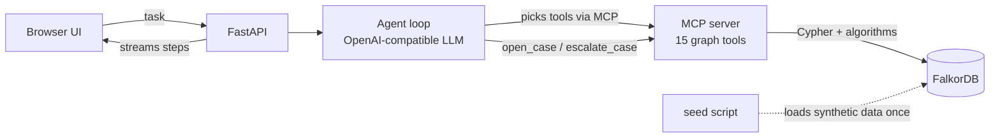
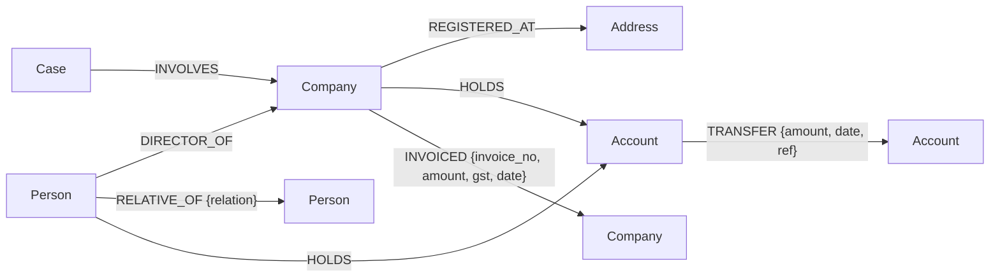

# TraceLedger

A forensic audit agent for CA firms. It works on a FalkorDB graph of a firm's clients (companies, directors, their families, addresses, bank accounts, money transfers and GST invoices), follows the connections to find fraud, writes what it found back into the graph as a case, and shows the exact path behind every finding.

**Track:** 01, Agents That Act on Connected Data

## The problem

When a CA audits a company, the cheating usually doesn't sit in one transaction. Each payment looks normal on its own. It only shows up when you follow the links:

- A client buys a lot from a "vendor" that turns out to be run by the director's brother-in-law, and the money comes back to the director a few days later.
- Four shell companies registered at the same shop invoice each other in a loop to create fake GST input credit, then sell "on paper" to a real client.
- A big payment is split into five smaller ones through personal accounts and joined again at a company run by the sender's wife.
- One "collection" account that many unrelated companies pay into and that passes the money straight on.

Finding these by hand means jumping between bank statements, MCA director records and GST data. In a graph it's a few hops.

## What the agent does

1. You give it a task: "Investigate Sharma Traders", or "Scan the portfolio".
2. It picks graph tools through MCP, one at a time. What it calls next depends on what the last tool showed.
3. When it has proof, it **acts**: creates a `Case` node in the graph linked to every entity involved, sets a risk score, drafts a polite query note for the client, and escalates high-risk cases to the partner.
4. Next session, it checks `get_prior_cases` first, so it knows what the firm already flagged.
5. The UI shows every tool call, the path text ("A --paid ₹31L--> B --paid ₹23.7L--> C"), and draws only the evidence path on the graph.

Take FalkorDB out and nothing works: every finding is a graph traversal or a graph algorithm.

## Architecture



| Part | File | Job |
|---|---|---|
| Graph | FalkorDB | All facts and links, plus the cases the agent writes |
| Graph tools | `app/queries.py` | Every Cypher query and graph algorithm |
| MCP server | `app/mcp_server.py` | Exposes those functions as MCP tools |
| Agent | `app/agent.py` | Connects to the MCP server, lets the LLM choose tools, loops until done |
| API | `app/api.py` | Runs the agent and streams each step to the UI |
| UI | `app/static/index.html` | Task box, agent trail, evidence graph, case cards |
| Data | `data/generate.py`, `data/seed.py` | Makes and loads the synthetic dataset |

## Graph data model



| Node | Properties |
|---|---|
| `Person` | id, name, pan, city |
| `Company` | id, name, gstin, city, incorporated_on, is_client |
| `Account` | id, name, bank, number |
| `Address` | id, name, city |
| `Case` (written by the agent) | id, title, risk_score, risk_level, summary, evidence, client_query_note, recommended_action, status, created_at |

The seed data has 173 nodes and ~600 edges: 24 normal companies trading in one direction (so normal trade never loops), plus the 4 planted patterns above. All names, PANs, GSTINs and accounts are made up.

## Graph queries and algorithms the product depends on

All of them are in `app/queries.py`. The important ones:

**GST invoice loop** (multi-hop cycle)
```cypher
MATCH p=(c:Company {id:$id})-[:INVOICED*2..6]->(c)
RETURN p LIMIT 300
```

**Money coming back to insiders** (round-tripping through a middle party)
```cypher
MATCH (c:Company {id:$id})-[:HOLDS]->(src:Account)
MATCH (c)<-[:DIRECTOR_OF]-(d:Person)
OPTIONAL MATCH (d)-[:RELATIVE_OF]-(r:Person)
WITH src, collect(DISTINCT d) + collect(DISTINCT r) AS people
UNWIND people AS person
MATCH (person)-[:HOLDS]->(dst:Account)
MATCH p=(src)-[:TRANSFER*2..4]->(dst)
RETURN p LIMIT 200
```

**Hidden link between two parties** (ownership, family or shared address)
```cypher
MATCH (a {id:$a}), (b {id:$b})
MATCH p=(a)-[:DIRECTOR_OF|RELATIVE_OF|REGISTERED_AT|HOLDS*1..5]-(b)
RETURN p, length(p) AS len ORDER BY len LIMIT 3
```

**Money trail / split payments**
```cypher
MATCH (s:Account) WHERE s.id IN $src
MATCH (t:Account) WHERE t.id IN $dst
MATCH p=(s)-[:TRANSFER*1..4]->(t)
RETURN p LIMIT 200
```
Then only routes that move forward in time are kept.

**Hub accounts**, betweenness centrality
```cypher
CALL algo.betweenness({nodeLabels:['Account'], relationshipTypes:['TRANSFER']})
YIELD node, score
```

**Companies under common control**, weakly connected components
```cypher
CALL algo.WCC({nodeLabels:['Company','Person','Address'],
               relationshipTypes:['DIRECTOR_OF','RELATIVE_OF','REGISTERED_AT']})
YIELD node, componentId
```
Then each group is ranked by how much its companies invoice and pay each other.

**Memory across sessions**
```cypher
MATCH (k:Case)-[:INVOLVES]->({id:$id}) RETURN k
```

## MCP tools

| Tool | What it does |
|---|---|
| `search_entity` | Find a company, person, account or address by name |
| `entity_profile` | Directors, address, accounts, top buyers/sellers, top payers/payees, prior cases |
| `scan_portfolio` | First pass over everything: invoice loops, tight groups, hub accounts, shared addresses |
| `find_invoice_cycles` | GST circular trading |
| `find_money_cycles` | Money that returns to the same account |
| `find_round_tripping` | Money that returns to the company's own directors or their family |
| `find_related_counterparties` | Which trading partners are secretly connected |
| `explain_link` | Shortest ownership/family/address link between two parties |
| `trace_money` | Time-ordered money routes between two parties, flags split payments |
| `find_hub_accounts` | Betweenness centrality on the money graph |
| `find_control_groups` | Connected components on control links, ranked by trade inside the group |
| `find_shell_clusters` | Addresses with many companies |
| `get_prior_cases` | What the firm flagged before |
| `open_case` | **Action**: write a Case into the graph |
| `escalate_case` | **Action**: send a case to the partner |

The MCP server also works on its own with any MCP client (Claude Desktop, Cursor, Windsurf):

```json
{
  "mcpServers": {
    "traceledger": {
      "command": "python",
      "args": ["-m", "app.mcp_server"],
      "cwd": "/path/to/traceledger"
    }
  }
}
```

## Run it

You need Python 3.10+ and an API key for any OpenAI-compatible LLM that supports tool calling (Groq, Gemini, OpenAI, OpenRouter) or a local Ollama model.

### With Docker

```bash
cp .env.example .env        # put your LLM settings in
docker compose up --build
```

Open http://localhost:8000. The FalkorDB Browser is at http://localhost:3000 if you want to look at the graph yourself.

### Without Docker

```bash
python -m venv .venv
source .venv/bin/activate          # Windows: .venv\Scripts\activate
pip install -r requirements.txt
cp .env.example .env               # put your LLM settings in

# 1. start FalkorDB (pick one)
docker run -p 6379:6379 -p 3000:3000 falkordb/falkordb:latest
#   or, no Docker at all:
pip install falkordblite && python scripts/local_falkordb.py

# 2. load the data (new terminal)
python data/generate.py
python -m data.seed

# 3. run
uvicorn app.api:app --reload
```

Open http://localhost:8000 and click one of the example tasks.

Run the agent from the terminal instead:

```bash
python -m app.agent "Investigate Sharma Traders"
```

`python -m data.seed` resets the graph (and removes saved cases). Use `python -m data.seed --if-empty` to keep them.

## Demo tasks

| Task | What the agent should find |
|---|---|
| Investigate Sharma Traders | Kavya Supplies is run by the director's brother-in-law, and ~90% of each payment comes back to the director 3 days later |
| Deccan Steel's GST credit from Shreeji Impex | Shreeji is one of 4 companies at one shop, invoicing each other in a loop 3 times |
| Northstar's ₹95L advances | Split 5 ways through personal accounts, rejoined at Zenith Holdings, run by the director's wife |
| Scan portfolio | All of the above plus the QuickPay hub account |

## Project structure

```
app/
  db.py            FalkorDB connection, turns results into plain dicts
  queries.py       all Cypher queries and graph algorithms
  mcp_server.py    MCP server exposing the queries as tools
  agent.py         agent loop (MCP client + LLM)
  api.py           FastAPI backend with streaming
  static/index.html  UI
data/
  generate.py      makes the synthetic dataset
  seed.py          loads it into FalkorDB
  seed.json        the generated data
scripts/
  local_falkordb.py  FalkorDB without Docker
```
